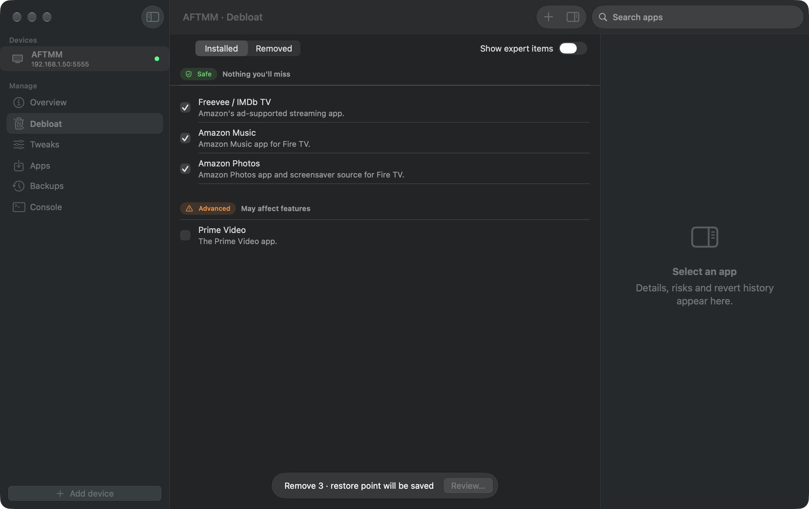
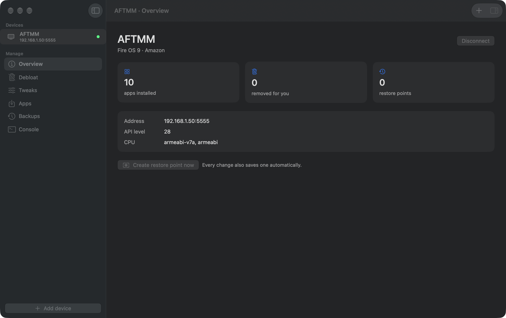
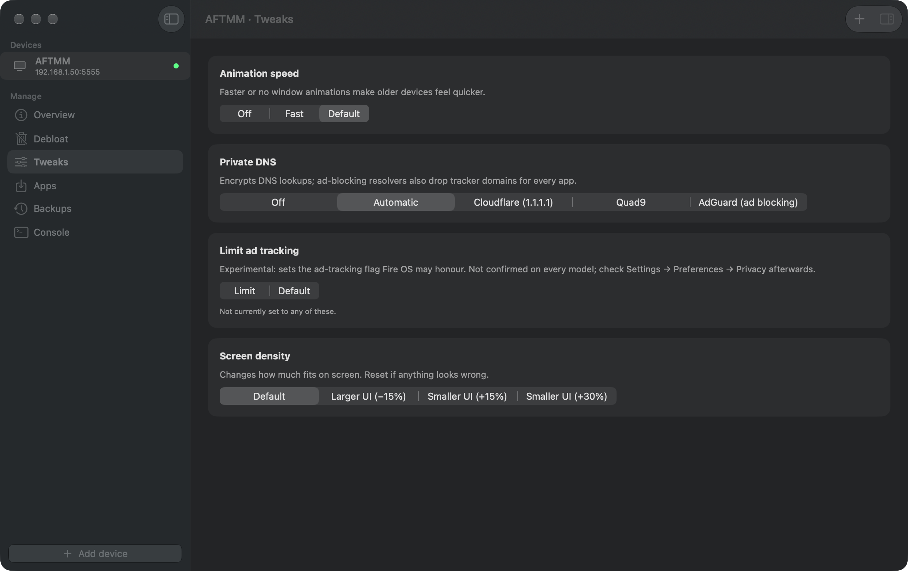
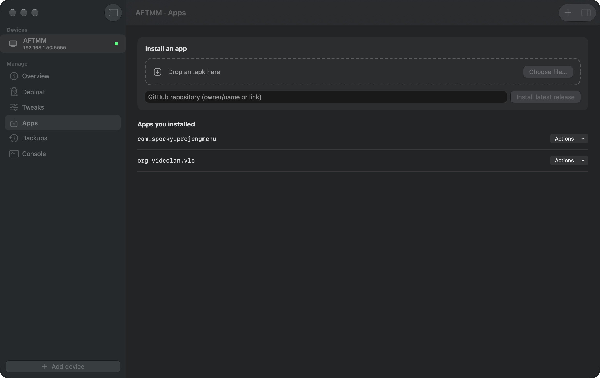
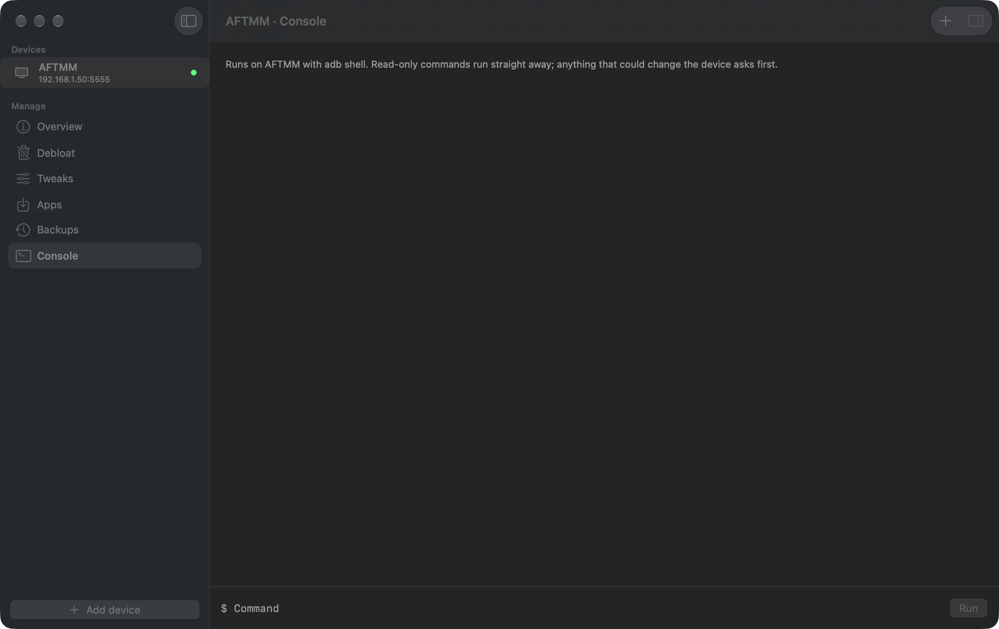

# Tether

A native macOS app for tidying Android-based devices over the network: back up, remove bloat and
trackers you don't want, apply a few reversible tweaks, and sideload apps from a GitHub release or
a file. Built with SwiftUI and Liquid Glass for macOS 26+.



> **Status: pre-release.** The core is covered by automated tests against a scripted fake `adb`,
> but it has **not yet been run on real hardware**. Work through
> [docs/device-checklist.md](docs/device-checklist.md) before trusting it with a device you care about.

## What it does

- **Connects over the network** to Fire TV (Fire OS), Android TV and Android phones: Bonjour discovery,
  wireless-pairing codes, or a manual IP address.
- **Restore points.** Before every change Tether saves the app list and states, the APKs of anything it
  is about to remove, and the relevant settings. Revert any change in one click.
- **Debloat** from a curated catalogue with risk tiers (Safe, Recommended, Advanced, Expert), a plain-English
  description and a "what may break" note for each app. Removal is `pm uninstall -k --user 0`, which is reversible.
- **Tweaks:** animation speed, screen density, private DNS, screen timeout, screensaver, and an experimental
  Fire TV ad-tracking flag.
- **Apps:** drop an `.apk`, or paste a GitHub repository to install its latest release (ABI-matched,
  size- and checksum-verified).
- **Console:** raw `adb shell` with a guard: read-only commands run, everything else asks first.

| | |
|---|---|
|  |  |
|  |  |

## Build and install

```sh
./scripts/bundle.sh        # downloads Google's platform-tools, builds build/Tether.app (adb inside)
open build/Tether.app
```

The app is ad-hoc signed, not notarised. On first launch macOS may refuse it: right-click the app → **Open**,
or run `xattr -dr com.apple.quarantine build/Tether.app`. `adb` is fetched at build time from
`dl.google.com` and checked against a pinned SHA-256; it is never committed to this repository.

`swift test` runs the suite (about 25 s). `./scripts/screenshots.sh` rebuilds the screenshots against a demo device and
doubles as a launch smoke test; `demo/run.sh` opens the app on that demo device without touching real data.

## Safety model

See [docs/safety-model.md](docs/safety-model.md). In short: no change without a verified restore point, one
code path for every mutation, and strict validation of anything that reaches the device's shell.

## Roadmap

1. Slice A (this): core, Android and Fire OS.
2. Slice B: Samsung Tizen TVs via `sdb`.
3. Later: Fire TV's newer Vega OS, if its tooling allows.

More: [architecture](docs/architecture.md) · [catalogue format](docs/catalog-format.md) ·
[Fire TV setup](docs/setup/fire-tv.md) · [Android setup](docs/setup/android.md)
